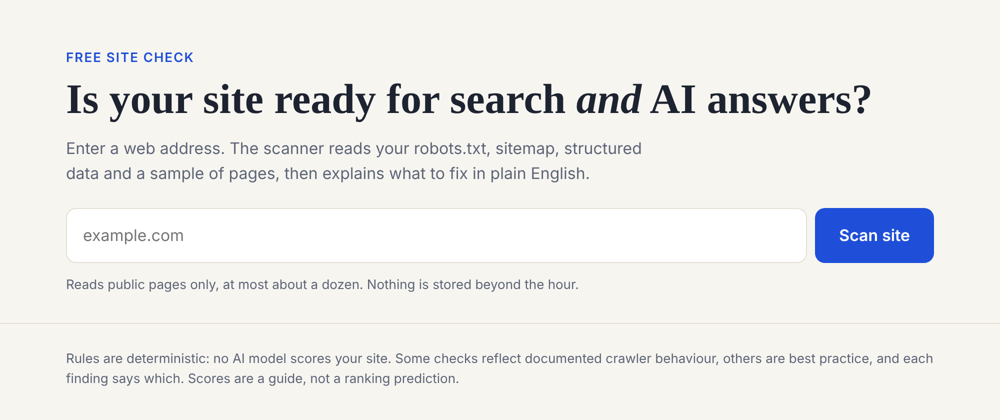
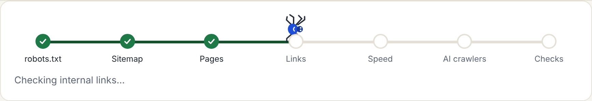
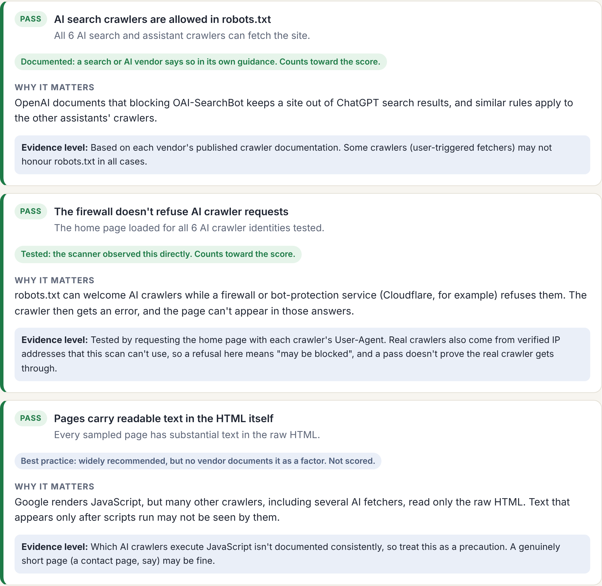
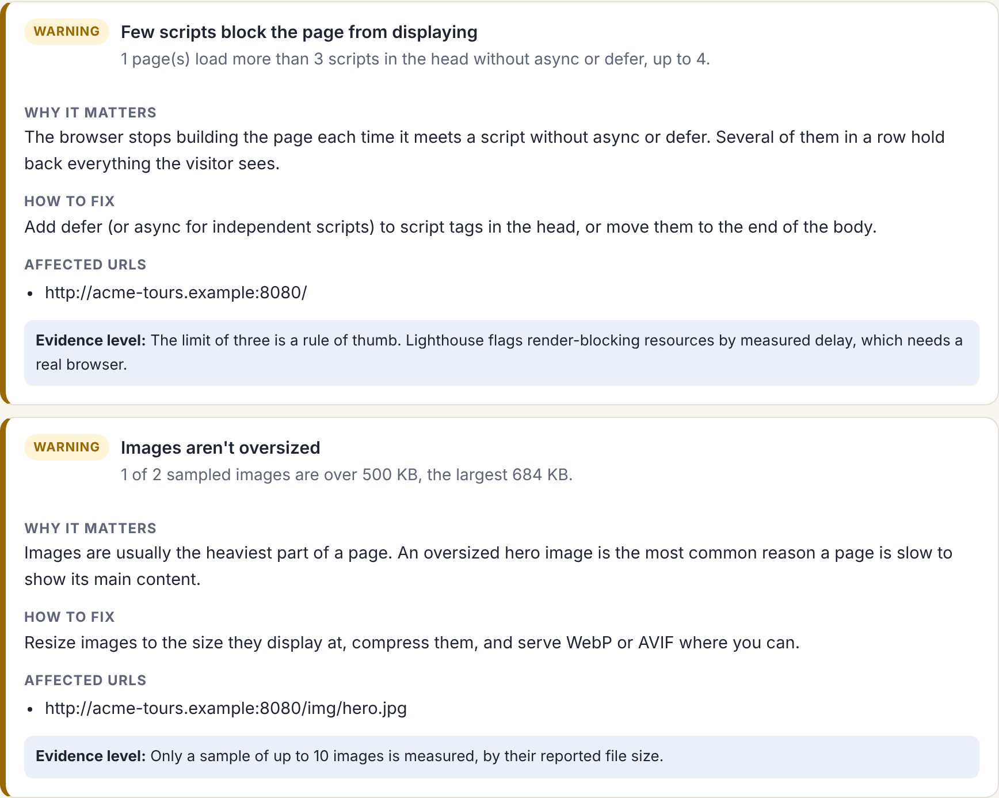
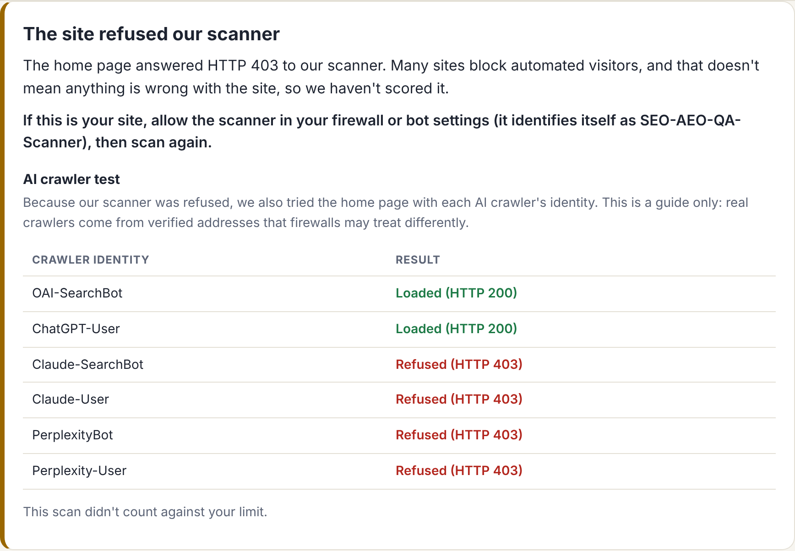
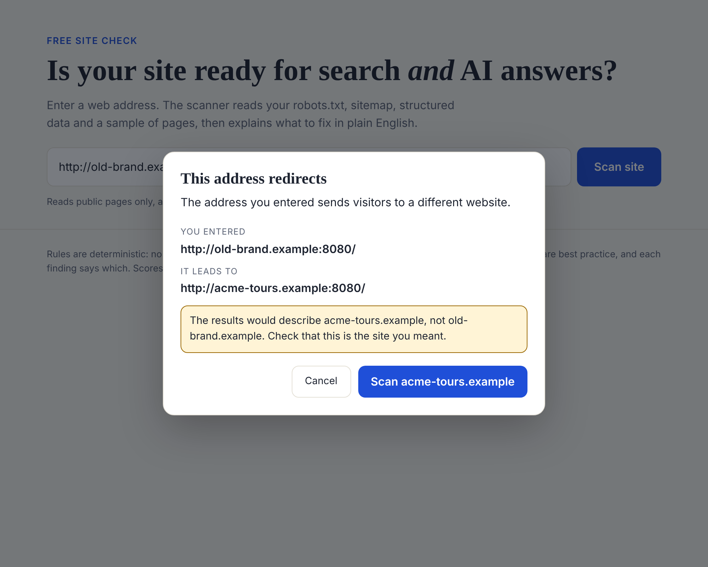
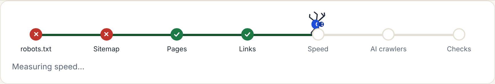
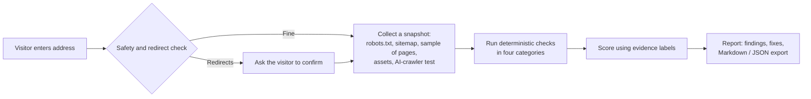

# SEO & AI-Readiness Scanner

**A free web tool that checks whether a website is ready for search engines *and* AI answers, then explains what to fix in plain English.**

> **[Try the live demo →](LIVE_DEMO_URL)** &nbsp;·&nbsp; Built by [Daniel Leewood](https://leewoodconsulting.com)
>
> *The demo runs on a free hosting tier. If it hasn't been used for a while, the first load can take 30–60 seconds to wake up.*

---

## Why I built it

Clients keep asking some version of "is our website set up so Google, and now ChatGPT and Claude, can find and understand it?" The honest answer lives across a dozen different tools and a lot of conflicting advice. I wanted one place that gives a straight answer, shows its evidence, and is upfront about what it *doesn't* know.

This project is also a working example of how I approach implementation and operations work: define the problem tightly, make the trade-offs explicit, test against reality, and keep the output trustworthy over impressive.

**How it was built:** I designed and directed the product (scope, rules, user experience, failure behaviour and every trade-off below) and built it with Claude as an AI pair-programmer. Every behaviour was tested, and the first real-world scans sent me back to fix things.

---

## What it does

Enter a web address. In a few seconds the tool reads the site's public files and a sample of its pages, runs **70+ checks**, and returns a scored report in four categories:

| Category | What it looks at |
|---|---|
| **Structured data** | Whether the site's schema.org markup is valid, correctly typed, linked together, and consistent with its sitemap |
| **Crawl and indexing** | robots.txt, sitemap, status codes, redirects, titles, descriptions, canonicals, broken links, plus spam-policy signals: hidden text, whether crawlers are shown the same page as visitors (cloaking), and unnatural repetition |
| **Speed** | Server response time, compression, page and image weight, render-blocking scripts, caching |
| **AI readiness** | Whether AI search crawlers can actually reach and read the site, including a test for firewalls that quietly turn them away |

Every finding says **what was found, why it matters, how to fix it,** and **how strong the evidence is.**

---

## The decisions I'm proudest of

Most tools in this space optimise for a big, alarming score. I optimised for being right and being fair.

| Decision | Why |
|---|---|
| **No AI model in the scoring.** Every rule is deterministic. | The same site gets the same result every time, and every finding can be explained and audited. |
| **Spam signals are split by how provable they are.** Cloaking is observed by requesting the page as a browser, Googlebot, a phone and a visitor from Google. Keyword repetition is a statistical hint, shown as information and never scored. | Google defines both by intent and publishes no numbers. A scanner can show what it saw, not what someone meant, so only the observed one is allowed to affect a score. |
| **Every AI-readiness check carries an evidence label**: *Documented*, *Tested*, *Best practice* or *Info*. Only the first two affect the score. | Nobody publishes how AI tools choose what to cite. Most "AI SEO" advice is guesswork presented as fact, so the score only counts what a vendor documents or what the tool can observe directly. |
| **A site that refuses the scanner gets an explanation, not a score.** | A firewall blocking our scanner says nothing about the site's quality. A made-up "F" would be wrong and unfair. |
| **Failed scans never count against a visitor's limit.** | Mistyped addresses and down servers shouldn't use up someone's allowance. |
| **Partial failures are visible.** A step that can't complete turns red with an ✕, and a banner explains which checks may be incomplete. | A report that silently skips a step is worse than no report. |
| **Redirects stop and ask.** If an address leads to a different site or page, the tool says so and asks before scanning. | Otherwise the report would describe a site the user didn't mean. Tidy changes (http→https, www) are applied silently. |
| **The report always says how much it looked at**: "Sampled 12 of 615 pages". Pages are spread across sections of the site. | A sample shouldn't pass as a full audit, and 500 blog posts shouldn't crowd out the service pages. |
| **The limits are stated, not hidden.** Speed is measured from one location. AI checks don't predict citations. | Trust comes from saying what the tool can't see. |

---

## A look at the experience

**A live progress tracker** shows the real stages of the scan as they happen, and a small spider crawls from stage to stage.

**Evidence labels** show how much weight each finding deserves:

**Plain-English fixes** come with every finding, including affected URLs:

**When a site refuses the scanner,** the tool explains and, as a bonus, tests whether AI crawlers would get through:

**When an address redirects,** the user confirms before anything is scanned:

**When part of a scan fails,** the failure is shown honestly and the rest still runs:

*Screenshots are scans of a fictional demo site I built with deliberate flaws, so each kind of finding appears.*

---

## How it works

- **Python / Flask** back end, **plain HTML, CSS and JavaScript** front end (no framework needed)
- **Safety by design:** the scanner only fetches public web addresses, re-checks every redirect, caps page sizes and scan time, and rate-limits per visitor and per target site so it can't be used to hammer anyone
- **Schema validation** uses the full, current schema.org type hierarchy bundled with the app
- **77 automated tests**, run against purpose-built "good" and "bad" test sites, including every failure path above
- Containerised and deployed on a free hosting tier

---

## Tested against reality

The first real-world scan found two false alarms: a rare-but-valid schema type reported as unrecognised, and a business profile check that only looked at the first entity on the page. I traced both to their causes and replaced the underlying approach (the full schema.org vocabulary and subtype relationships instead of a hand-picked list). Scanning real sites, not just my own test sites, is what made the tool trustworthy.

---

## What it deliberately doesn't do

- It checks a **sample** of pages, not an entire site
- It doesn't render JavaScript, so it can't measure real-browser metrics such as Core Web Vitals
- It doesn't predict rankings or AI citations, and says so on the report
- It validates schema.org **types**, not every property. Google's Rich Results Test and the Schema Markup Validator remain the final word

## What I'd build next

- Social share-preview checks (image size, weight, and tags)
- Saved reports and before/after comparisons for ongoing monitoring
- Optional plain-language summaries written by an AI model, kept clearly separate from the deterministic score

---

## About me

I'm Daniel Leewood, an independent consultant focused on **operations, implementation and RevOps**. I run [Leewood Consulting](https://leewoodconsulting.com), where I help small and mid-sized businesses turn messy processes and systems into things that work. This project shows how I work: scoping tightly, testing hard, and being clear about trade-offs.

**The source code is private.** I'm glad to walk through it on a call or share access as part of a hiring process.

---

*Schema type data derived from [schema.org](https://schema.org), used under [CC BY-SA 3.0](https://creativecommons.org/licenses/by-sa/3.0/).*
