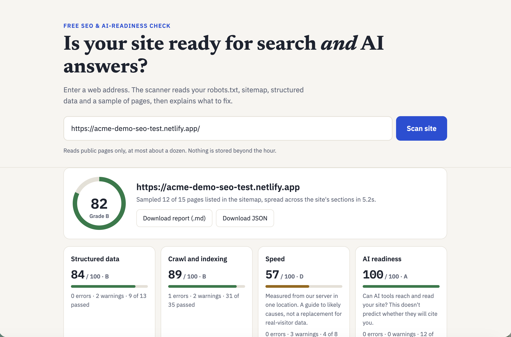
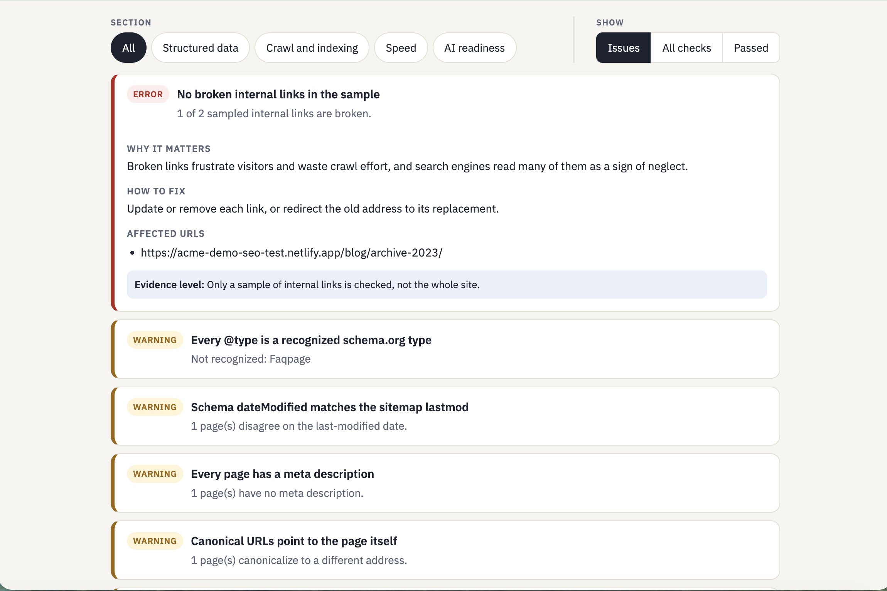
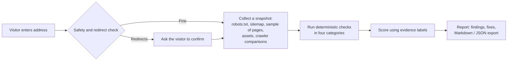

# SEO & AI-Readiness Scanner

**A working web tool that audits a website for search and AI readiness. I built it as a portfolio project to show how I scope, implement, test and explain technical work.**

> **[Try the live demo →](LIVE_DEMO_URL)** &nbsp;·&nbsp; Built by Daniel Leewood &nbsp;·&nbsp; [LinkedIn](LINKEDIN_URL)
>
> *The demo runs on a free hosting tier. If it hasn't been used for a while, the first load can take 30–60 seconds to wake up.*

---

## What this project shows

| What I wanted to demonstrate | How it shows up here |
|---|---|
| **Turning a vague question into a defined process** | "Is this site ready for search and AI answers?" became 70+ explicit rules in four categories. Every rule explains what was found, why it matters, how to fix it and how strong the evidence is. |
| **Thinking through edge cases before they happen** | I specified what happens when things go wrong: a site that refuses the scanner gets an explanation instead of a score, failed scans don't use up a visitor's allowance, a redirect stops and asks before scanning, and a partly failed scan says which steps failed. |
| **Quality assurance** | 80 automated tests run against purpose-built "good" and "bad" test sites. After that I scanned real websites, found false alarms, traced each to its cause and fixed the approach, not only the symptom. |
| **Technical SEO and AI search knowledge** | Structured data, crawling and indexing, speed, and whether AI crawlers can reach a site, plus signals drawn from Google's spam policies (cloaking, hidden text, unnatural repetition). |
| **Plain-language communication** | Findings are written for a business owner, not an engineer. The report states what it can't see rather than overclaiming. |
| **Working effectively with AI tools** | I designed and directed the product and built it with Claude as an AI pair-programmer. I set the scope, the rules and the acceptance criteria, reviewed the results, and kept the scoring itself free of AI so it stays explainable. |

---

## Why I built it

I'm often asked some version of "is our website set up so Google, and now ChatGPT and Claude, can find and understand it?" I wanted a free tool that answers that by checking a site against Google's published guidance and whether AI crawlers are allowed in robots.txt.

It also reflects how I approach SEO work: first identify and resolve the technical gaps directly within my control (the website), then optimize the external directories where the business is listed.

---

## What it does

Enter a web address. In under a minute the tool reads the site's public files and a sample of its pages, runs **70+ checks**, and returns a scored report in four categories:

| Category | What it looks at |
|---|---|
| **Structured data** | Whether the site's schema.org markup is valid, correctly typed, linked together, and consistent with its sitemap |
| **Crawl and indexing** | robots.txt, sitemap, status codes, redirects, titles, descriptions, canonicals, broken links, plus spam-policy signals: hidden text, whether crawlers are shown the same page as visitors (cloaking), and unnatural repetition |
| **Speed** | Server response time, compression, page and image weight, render-blocking scripts, caching |
| **AI readiness** | Whether AI search crawlers can actually reach and read the site, including a test for firewalls that quietly turn them away |

---

## Judgment calls I made

The tool could have been built to produce the biggest, scariest score. I built it to be accurate and fair.

| Decision | Why |
|---|---|
| **No AI model in the scoring.** Every rule is deterministic. | The same site gets the same result every time, and every finding can be explained and audited. |
| **Every AI-readiness check carries an evidence label**: *Documented*, *Tested*, *Best practice* or *Info*. Only the first two affect the score. | Nobody publishes how AI tools choose what to cite. Most "AI SEO" advice is guesswork presented as fact, so the score only counts what a vendor documents or what the tool can observe directly. |
| **Spam signals are separated by how provable they are.** Cloaking and hidden text are detected from what the scanner can observe, and can affect the score. Keyword repetition is a statistical hint, shown as information and never scored. | Google defines these by intent and publishes no numbers for repetition. A scanner can show what it saw, not what someone meant. |
| **A site that refuses the scanner gets an explanation, not a score.** | A firewall blocking the scanner says nothing about the site's quality. A made-up "F" would be wrong and unfair. |
| **Failed scans never count against a visitor's limit.** | Mistyped addresses and down servers shouldn't use up someone's allowance. |
| **Partial failures are visible.** A step that can't complete turns red with an ✕, and a banner explains which checks may be incomplete. | A report that silently skips a step is worse than no report. |
| **Redirects stop and ask.** If an address leads to a different site or page, the tool says so and asks before scanning. | Otherwise the report would describe a site the user didn't mean. Tidy changes (http→https, www) are applied silently. |
| **The report always says how much it looked at**: for example "Sampled 12 of 15 pages". Pages are spread across sections of the site. | A sample shouldn't pass as a full audit, and 500 blog posts shouldn't crowd out the service pages. |
| **The limits are stated, not hidden.** Speed is measured from one location. AI checks don't predict citations. | Trust comes from saying what the tool can't see. |

---

## How it was built: test, fix, repeat

I treat a real website as the test that counts, so most improvements came from scanning real sites.

- **A false alarm on a valid schema type.** The first real-world scan reported a rare-but-valid type as unrecognized, and a business-profile check only looked at the first entity on a page. I traced both to their causes and replaced the underlying approach with the full schema.org vocabulary and its subtype relationships, instead of a hand-picked list.
- **A slowdown I introduced.** After I added a new check, a scan of a large page timed out. I found the cause (the new check read each page's styling inefficiently), made it about 30 times faster, added a test so it can't quietly return, and added an overall time limit so one slow step can't cancel the rest.
- **Wording that overclaimed.** I reviewed the explanations against Google's own documentation and softened or relabeled the ones the documentation didn't fully support.

---

## What a finding looks like

Every finding says what was found, why it matters, how to fix it, and which pages are affected. Findings are labeled *Documented*, *Tested*, *Best practice* or *Info*, so a reader can see how much weight each one deserves. While a scan runs, a live progress tracker shows the real stages as they happen.

*Screenshots are scans of Acme Normandy Tours, a fictional demo site I built with deliberate flaws, so each kind of finding appears. You can scan it yourself: [acme-demo-seo-test.netlify.app](https://acme-demo-seo-test.netlify.app/).*

---

## How it works

- **Python / Flask** back end, **plain HTML, CSS and JavaScript** front end (no framework needed)
- **Safety by design:** the scanner only fetches public web addresses, re-checks every redirect, caps page sizes and scan time, and rate-limits per visitor and per target site so it can't be used to hammer anyone
- **Schema validation** uses the full, current schema.org type hierarchy bundled with the app
- **80 automated tests**, run against purpose-built "good" and "bad" test sites, including the failure paths above
- Containerised and deployed on a free hosting tier

---

## What it deliberately doesn't do

- It checks a **sample** of pages, not an entire site
- It doesn't render JavaScript, so it can't measure real-browser metrics such as Core Web Vitals
- It doesn't predict rankings or AI citations, and says so on the report
- It validates schema.org **types**, not every property. Google's Rich Results Test and the Schema Markup Validator remain the final word

## What I'd build next

- Social share-preview checks (image size, weight, and tags)
- Saved reports and before/after comparisons for ongoing monitoring
- Optional plain-language summaries written by an AI model, kept clearly separate from the deterministic score

---

## About me

I'm Daniel Leewood, with 7+ years across operations and implementation roles, based in Los Angeles. This project is how I like to work: define the problem tightly, make trade-offs explicit, test against reality, and explain the result plainly. [ONE_LINE_ABOUT_THE_ROLE_YOU_WANT]

**The source code is private.** I'm glad to walk through it on a call or share access as part of a hiring process.

[LinkedIn](LINKEDIN_URL)

---

*Schema type data derived from [schema.org](https://schema.org), used under [CC BY-SA 3.0](https://creativecommons.org/licenses/by-sa/3.0/).*
